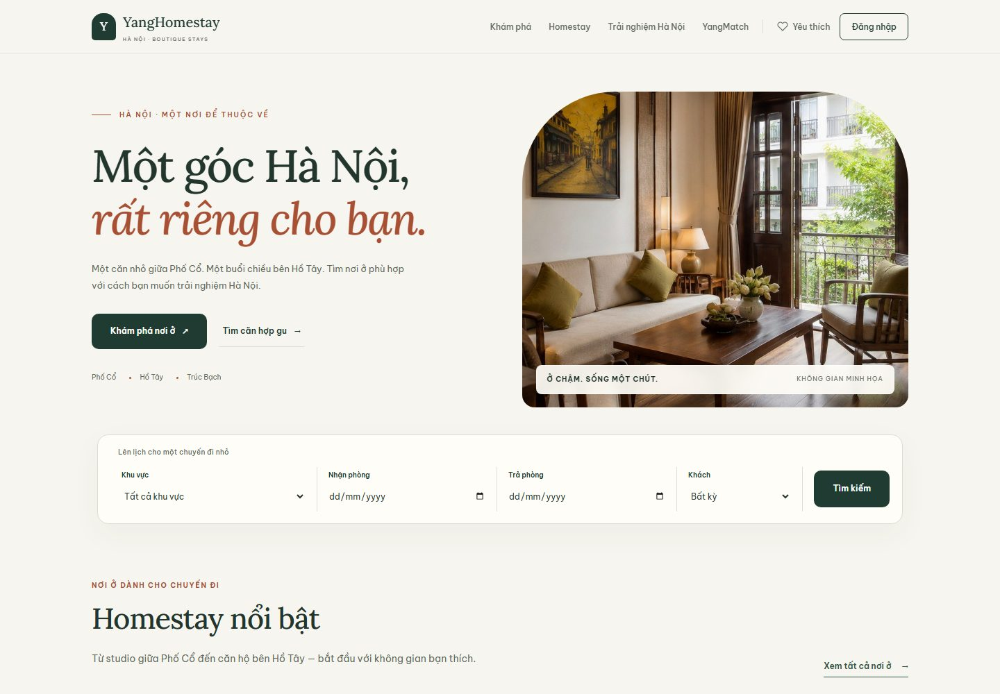
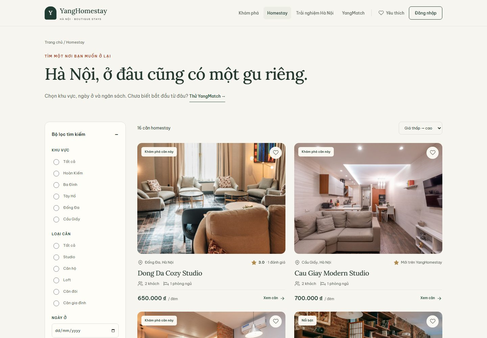
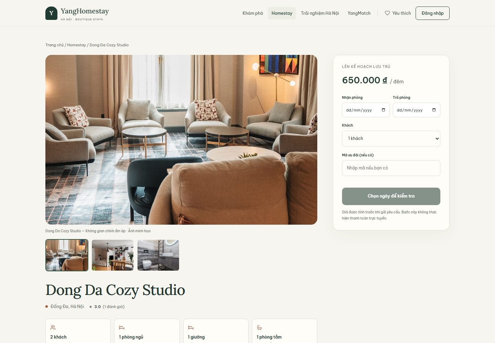
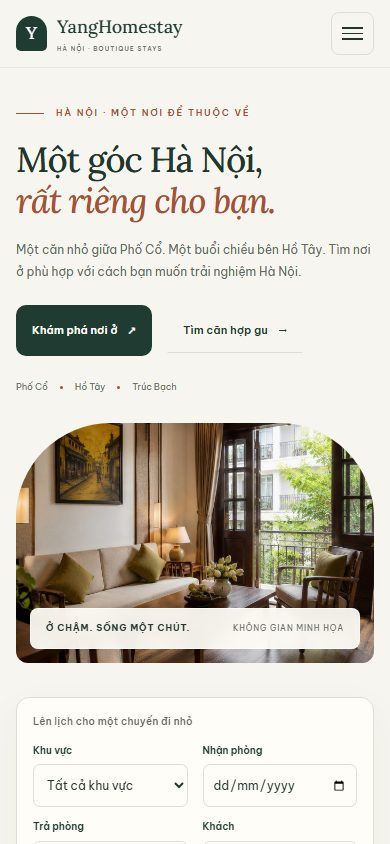

# YangHomestay

Website tìm và đặt homestay tại Hà Nội, xây dựng bằng PHP, JavaScript thuần
và Supabase PostgreSQL.

[Mở bản demo](https://yanghomestay.helioho.st/) ·
[Kiến trúc và đặt phòng](docs/architecture.md) ·
[Cài đặt](#cài-đặt) · [Kết quả kiểm tra](docs/verification.md)

Bản Spring Boot dùng lại giao diện khách cho luồng tìm căn, báo giá, đặt phòng và xem đơn.
Demo công khai ở trên chạy bản PHP. [Chạy bản Java với PostgreSQL](java-backend/README.md).



Ảnh chụp từ ứng dụng đang chạy; ảnh căn trong ứng dụng là stock cho dữ liệu demo,
không phải bằng chứng có phòng thật đang cho thuê. [Nguồn và phạm vi screenshot](docs/screenshots/README.md).

## Chức năng

- Tìm chỗ ở theo khu vực, ngày nhận/trả phòng và số khách.
- Xem ảnh, tiện nghi, sức chứa, giá và đánh giá của từng căn.
- Lưu yêu thích, gửi yêu cầu đặt chỗ và theo dõi lịch sử đặt.
- YangMatch gợi ý chỗ ở theo ngân sách, vị trí, tiện nghi và mục đích chuyến đi.
- Các khu vực làm việc riêng cho nhân viên, quản lý và quản trị viên.

YangMatch lọc theo điều kiện bắt buộc trước, sau đó tính điểm theo sở thích.
Backend tính giá đặt phòng và kiểm tra lịch trống; không dùng tổng tiền gửi từ trình duyệt.
Ngày nhận phòng được tính vào kỳ ở, ngày trả phòng không tính.

Điểm kỹ thuật chính là giữ việc xác nhận lịch và tính giá ở server: PHP lấy người
đặt từ Session, PostgreSQL khóa theo căn rồi kiểm tra lại overlap trong RPC trước
khi ghi booking và giá từng đêm. [Luồng chi tiết và giới hạn kiểm chứng](docs/architecture.md).

## Công nghệ

| Phần | Sử dụng |
| --- | --- |
| Giao diện | HTML, CSS, JavaScript |
| Backend | PHP 8+, Session, cURL |
| Database | Supabase PostgreSQL, REST và RPC |
| Máy chủ | Apache, mod_rewrite |

## Đọc mã và bằng chứng kỹ thuật

| Chủ đề | Điểm bắt đầu review |
| --- | --- |
| Quyền API | [Customer API và CSRF](backend/customer-api.php), [permission nội bộ](backend/lib/InternalAccess.php) |
| Đặt chỗ và giá | [BookingService](backend/services/BookingService.php), [RPC khóa theo căn và ghi snapshot giá](database/supabase/006_booking_rpc.sql) |
| Quyền gọi RPC | [Migration siết grant](database/supabase/009_security_hardening.sql) |
| Kiểm chứng | [Kết quả local và phạm vi chưa kiểm tra](docs/verification.md), [kịch bản test](docs/testing.md) |

[GitHub Actions](https://github.com/nguyenhonggiang2407/YangHomestay/actions/workflows/ci.yml)
kiểm tra cú pháp và chạy ba bộ test giá, khoảng ngày và phân quyền bằng dữ liệu cục bộ.
Kiểm thử RPC đồng thời cần Supabase thử riêng. Kết quả và phạm vi kiểm chứng hosting
được ghi trong [tài liệu kiểm chứng](docs/verification.md).

## Cài đặt

1. Đặt mã nguồn trong document root của Apache, ví dụ `C:\xampp\htdocs\YangHomestay`.
2. Bật PHP cURL và Apache mod_rewrite; cho phép sử dụng `.htaccess`.
3. Tạo database Supabase và chạy các tệp trong `database/supabase/` theo thứ tự số.
   Dữ liệu seed chỉ dùng cho database mới hoặc môi trường thử.
4. Sao chép `backend/config.supabase.example.php` thành `backend/config.supabase.local.php`,
   điền URL và khóa backend của Supabase.
5. Mở `http://localhost/YangHomestay/customer/`.

PowerShell trên XAMPP có thể dùng:

```powershell
Copy-Item backend/config.supabase.example.php backend/config.supabase.local.php
& C:\xampp\php\php.exe backend/tests/test-pricing.php
```

Chạy Apache để kiểm tra cả `.htaccess` và guard các portal; PHP built-in server
không thực thi các rewrite/quy tắc truy cập Apache này.

Khóa Supabase chỉ nằm ở backend; tệp cấu hình riêng đã được Git bỏ qua.
Các bước triển khai trên host và cập nhật database nằm trong [hướng dẫn triển khai](docs/deployment.md).

## Các khu vực sử dụng

| Khu vực | Đường dẫn |
| --- | --- |
| Khách hàng | `/customer/` |
| Nhân viên | `/staff/login.html` |
| Quản lý | `/manager/login.html` |
| Quản trị viên | `/admin/login.html` |

Quyền được kiểm tra ở backend qua Session, CSRF và RBAC.
Các yêu cầu đặt chỗ dùng RPC `create_booking_atomic` để kiểm tra và ghi dữ liệu trong cùng luồng.

## Cấu trúc

- `customer/`: tìm phòng, chi tiết căn, đặt chỗ và tài khoản khách.
- `admin/`, `manager/`, `staff/`: giao diện làm việc nội bộ.
- `backend/services/`: đặt phòng, giá, tài khoản, đánh giá và YangMatch.
- `backend/lib/`: kết nối Supabase, Session, CSRF và kiểm tra quyền.
- `database/supabase/`: schema, seed, chỉ mục và migration PostgreSQL.
- `database/`: tài liệu dữ liệu và lược đồ MySQL tham khảo.
- `assets/`: CSS, JavaScript và ảnh.
- `tools/`: các công cụ quản lý ảnh và dữ liệu.

## Kiểm tra

```bash
php backend/tests/test-pricing.php
php backend/tests/test-availability.php
php backend/tests/test-rbac.php
```

Xem [ghi chú kiểm thử](docs/testing.md) cho kiểm tra API, đặt phòng đồng thời
và các luồng cần thử trên trình duyệt.

## Tài liệu

- [Cấu trúc database](database/supabase/ERD.md)
- [Kiến trúc, tính giá và kiểm soát quyền](docs/architecture.md)
- [Triển khai](docs/deployment.md)
- [Nguồn ảnh](docs/image-sources.md)
- [Bảng gán ảnh](assets/images/image-map.md)
- [Lịch sử thay đổi](CHANGELOG.md)

Dữ liệu căn và ảnh stock dùng cho demo, không đại diện cho phòng đang được kinh doanh.
Dự án chưa tích hợp cổng thanh toán.

<details>
<summary>Tìm kiếm, chi tiết căn và giao diện điện thoại</summary>







</details>

## Nguồn và giấy phép

Giữ tài liệu [nguồn ảnh](docs/image-sources.md) và lịch sử mã nguồn hiện có.
Repository chưa khai báo giấy phép tổng thể cho mã ứng dụng; không suy ra quyền
tái sử dụng source từ việc repository công khai. Giấy phép ảnh và thư viện có
phạm vi riêng. Đợt cập nhật portfolio này không đổi quyền tác giả hoặc cấp phép
lại mã nguồn/ảnh đã có.
