# 🗺 ER Diagram — YangHomestay (PostgreSQL / Supabase)

ERD phản ánh schema thực tế trong `001_schema.sql` (giống domain model của bản MySQL).
Xem trên GitHub/GitLab hoặc paste vào https://mermaid.live.

---

## Mermaid

```mermaid
erDiagram
    %% ─── Danh mục / nhân sự ───
    ADMINS ||--o{ AVAILABILITY_BLOCKS : "chặn ngày (created_by)"
    ADMINS ||--o{ REVIEWS : "duyệt (approved_by)"
    ADMINS ||--o{ AUDIT_LOGS : "ghi log"
    ADMINS ||--o{ NOTIFICATIONS : "nhận thông báo (admin)"

    %% ─── Property → Unit ───
    PROPERTIES ||--o{ PROPERTY_IMAGES : "có ảnh"
    PROPERTIES ||--o{ UNITS : "gồm các căn"
    PROPERTIES ||--o{ NEARBY_PLACES : "có địa điểm lân cận"

    %% ─── Unit: đặc tính ───
    UNITS ||--o{ UNIT_IMAGES : "có ảnh"
    UNITS ||--o{ UNIT_AMENITIES : "có tiện nghi"
    AMENITIES ||--o{ UNIT_AMENITIES : ""
    UNITS ||--o{ UNIT_EXPERIENCE_TAGS : "có nhãn trải nghiệm"
    EXPERIENCE_TAGS ||--o{ UNIT_EXPERIENCE_TAGS : ""
    UNITS ||--o{ AVAILABILITY_BLOCKS : "bị chặn ngày"
    UNITS ||--o{ RATE_RULES : "có luật giá"

    %% ─── Booking ───
    CUSTOMERS ||--o{ BOOKINGS : "đặt"
    UNITS ||--o{ BOOKINGS : "được đặt"
    BOOKINGS ||--o{ BOOKING_NIGHTS : "snapshot từng đêm"
    BOOKINGS ||--o{ BOOKING_PRICE_ITEMS : "chi tiết dòng tiền"
    RATE_RULES ||--o{ BOOKING_NIGHTS : "áp dụng cho đêm"
    BOOKINGS ||--o| REVIEWS : "1 booking → tối đa 1 review"
    CUSTOMERS ||--o{ REVIEWS : "viết"
    UNITS ||--o{ REVIEWS : "được đánh giá"

    %% ─── Promotion ───
    PROMOTIONS ||--o{ BOOKINGS : "áp dụng (snapshot)"
    PROMOTIONS ||--o{ PROMOTION_USAGES : "được dùng"
    CUSTOMERS ||--o{ PROMOTION_USAGES : "dùng mã"
    BOOKINGS ||--o| PROMOTION_USAGES : "ghi nhận 1 lần"

    %% ─── Khác ───
    CUSTOMERS ||--o{ FAVORITES : "yêu thích"
    UNITS ||--o{ FAVORITES : "được yêu thích"
    CUSTOMERS ||--o{ NOTIFICATIONS : "nhận thông báo (customer)"
```

---

## Tóm tắt quan hệ chính

| Quan hệ | Cardinality | Ghi chú |
|---|---|---|
| Property → Unit | 1 → N | Booking luôn trỏ `unit_id` |
| Unit → Booking | 1 → N | Overlap chỉ tính status active |
| Customer → Booking | 1 → N | FK RESTRICT (giữ lịch sử) |
| Booking → BookingNight | 1 → N | Giá snapshot từng đêm |
| Booking → Review | 1 → 0..1 | `UNIQUE booking_id` = verified stay |
| Unit → Amenity | N ↔ M | Qua `unit_amenities` |
| Unit → ExperienceTag | N ↔ M | Qua `unit_experience_tags` (có weight) |
| Unit → AvailabilityBlock | 1 → N | start inclusive / end exclusive |
| Unit → RateRule | 1 → N | priority quyết định khi overlap |
| Promotion → Booking | 1 → N | `promotion_code_snapshot` giữ mã tại thời điểm đặt |
| Booking → PromotionUsage | 1 → 0..1 | `UNIQUE booking_id` |

---

## Bảng 24 — tổng quan

| # | Bảng | Mục đích |
|---|---|---|
| 1 | `admins` | Tài khoản quản trị (super_admin / manager / staff) |
| 2 | `customers` | Tài khoản khách hàng (data minimization) |
| 3 | `properties` | Cơ sở / vị trí lưu trú |
| 4 | `property_images` | Ảnh của property |
| 5 | `units` | Căn thực tế khách đặt |
| 6 | `unit_images` | Ảnh của unit |
| 7 | `amenities` | Danh mục tiện nghi |
| 8 | `unit_amenities` | Junction unit ↔ amenity |
| 9 | `experience_tags` | Nhãn trải nghiệm (YangMatch) |
| 10 | `unit_experience_tags` | Junction unit ↔ tag (có weight) |
| 11 | `availability_blocks` | Chặn ngày bán của unit |
| 12 | `rate_rules` | Luật giá (weekend / holiday / seasonal) |
| 13 | `promotions` | Mã khuyến mãi |
| 14 | `bookings` | Đặt phòng (bảng trung tâm) |
| 15 | `booking_nights` | Price snapshot theo từng đêm |
| 16 | `booking_price_items` | Dòng tiền hiển thị hóa đơn |
| 17 | `promotion_usages` | Lịch sử dùng mã |
| 18 | `favorites` | Yêu thích của khách |
| 19 | `reviews` | Đánh giá gắn booking thật |
| 20 | `nearby_places` | Địa điểm lân cận |
| 21 | `notifications` | Thông báo customer / admin |
| 22 | `contact_messages` | Tin nhắn liên hệ |
| 23 | `login_logs` | Lịch sử đăng nhập (không FK) |
| 24 | `audit_logs` | Nhật ký thao tác admin (JSONB) |
