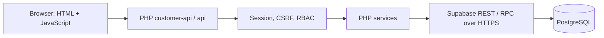

# Kiến trúc và nghiệp vụ đặt phòng

Backend dùng cURL đến Supabase Data API, không yêu cầu PHP kết nối trực tiếp cổng
PostgreSQL. Secret của backend nằm trong cấu hình máy chủ và header HTTPS; client
chỉ gọi PHP API. Bản MySQL trong `database/` là tài liệu legacy/tham khảo, không
phải đường chạy chính của các service hiện tại.

## Từ tìm kiếm đến đặt chỗ

1. `UnitService` trả danh sách/căn theo bộ lọc và ngày; `AvailabilityService` dùng
   RPC để kiểm tra booking đang chặn và khoảng ngày không bán được.
2. `PricingService::quote()` tính báo giá server từ unit, rate rule và promotion.
   Báo giá hiển thị chưa giữ chỗ và chưa đảm bảo căn vẫn trống khi gửi booking.
3. Khách đã đăng nhập gửi căn, ngày, số khách và mã ưu đãi đến `BookingService`.
   `customer_id` luôn lấy từ Session. Tổng tiền browser gửi không quyết định giá.
4. RPC `create_booking_atomic` khóa theo `unit_id` bằng `pg_advisory_xact_lock`,
   kiểm tra lại overlap/sức chứa và ưu đãi, tính giá từng đêm rồi ghi booking,
   snapshot giá và các dòng tiền trong cùng transaction.
5. Xung đột lịch trả `409`; sai ngày/sức chứa/ưu đãi trả `422`. Khách đọc hoặc
   hủy đơn qua bộ lọc `customer_id` ở backend; hủy chỉ áp dụng trạng thái cho phép.

Khoảng lưu trú là `[check_in, check_out)`: trả phòng ngày 23 cho phép khách khác
nhận phòng cùng ngày. Các trạng thái `pending`, `confirmed`, `checkin` chặn lịch;
`checkout`, `cancelled` không chặn. Snapshot trong `booking_nights` giữ giá đặt
ban đầu khi rate rule thay đổi về sau.

## Mô hình dữ liệu chính

| Nhóm | Quan hệ và mục đích |
| --- | --- |
| Catalog | `properties` có nhiều `units`; căn có ảnh, tiện nghi và experience tags. |
| Lịch | Booking hoạt động và `availability_blocks` cùng quyết định lịch trống. |
| Đặt chỗ | `bookings` gắn với `customers` và `units`; không đặt trực tiếp property. |
| Giá | `rate_rules` quyết định từng đêm; `booking_nights` và `booking_price_items` lưu snapshot. |
| Ưu đãi | `promotions` và `promotion_usages` lưu điều kiện và số lượt sử dụng. |
| Phản hồi | Review gắn với booking đã checkout của chính khách; cần duyệt trước khi công khai. |
| Nội bộ | `admins` có vai trò; `audit_logs` ghi các thay đổi nội bộ được hỗ trợ. |

Xem [ERD Supabase](../database/supabase/ERD.md) và [thứ tự migration](../database/supabase/README.md).
Seed có thao tác đặt lại dữ liệu; chỉ áp dụng cho database thử mới, không dùng để
nâng cấp database đang sử dụng.

## Kiểm soát quyền

`backend/lib/InternalAccess.php` ánh xạ action API sang permission. Menu frontend
không quyết định quyền. Danh tính khách lấy từ `customer_id` trong Session; thao tác ghi cần CSRF, kể cả
đăng nhập/đăng ký. Tài khoản nội bộ còn được kiểm tra trạng thái ở database.

| Vai trò nội bộ | Phạm vi tiêu biểu |
| --- | --- |
| `staff` | Hàng đợi, lịch, khách, xem và đổi trạng thái booking. |
| `manager` | Thêm quyền quản lý catalog, giá, ưu đãi, thanh toán và duyệt review. |
| `super_admin` | Thêm quyền quản lý tài khoản nội bộ và xem cấu hình hệ thống. |

Các grant RPC được siết trong migration `009_security_hardening.sql`: secret
backend cần được giữ kín, và PHP phải kiểm tra quyền trước khi dùng service role.

## Giới hạn

Không có cổng thanh toán thật. Dữ liệu chỗ ở, review và stock photography phục vụ
demo, không phải bằng chứng vận hành kinh doanh. Unit test thuần xác minh pricing,
date convention và policy quyền; nó không thay kiểm thử RPC đồng thời trên
database. Các bài live/concurrency tạo dữ liệu nên chỉ chạy trên Supabase thử
riêng đã cấu hình. Xem [kết quả đã thực hiện](verification.md).
